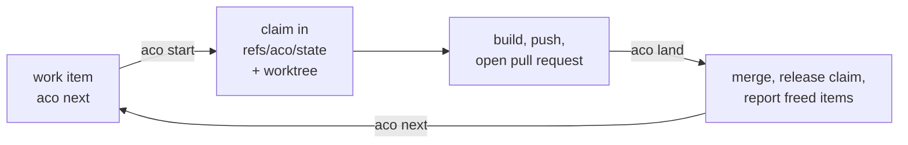

# agent-coordination

`aco` gives coding agents and the people steering them one claim state per
repository: a compare-and-swap git ref, `refs/aco/state`, on the repository's
canonical remote. It is provider-neutral: Codex, Claude, Grok and people use the
same contract. Read this file to install `aco` and run one lane; each command's
exact behaviour is in its spec under `specs/`.

## What aco is for, and is not

A capability belongs in `aco` only if it helps agents coordinate in a shared
repository, holds what an agent would forget or cannot know alone (who holds
what, what a landing freed, what is disjoint), and no native tool does it
better. Git, `gh` and the forge own commits, branches, pull requests and issue
text. aco runs no lease server and writes no provider configuration. GitHub
through `gh` is the one forge adapter; `status`, `bootstrap`, `reset` and lane
`claim`/`rescope`/`release` read and write only `refs/aco/state` and need no forge.

## Install

```bash
uv tool install git+https://github.com/overnightworks/agent-coordination.git
# or: pipx install git+https://github.com/overnightworks/agent-coordination.git
uv tool upgrade agent-coordination
uv tool uninstall agent-coordination
```

The supported Python range is in `pyproject.toml`.

## One lane



Set `ACO_AGENT` to the agent's name once: `start` refuses in a plain
shell without it. A repository adopts aco by landing one commit that adds an
empty `.aco/board.toml` and nothing else, then runs `aco bootstrap` once to
create the state ref (`specs/bootstrap.spec.md`, `specs/storage-pin.spec.md`).
After that: `aco next` names the item to pull, `aco start <n>` creates its
worktree and branch and claims its scope, `aco brief <n>` prints what a builder
starts from, and `aco land <pull request> --head <sha>`, from a clean
default-branch checkout, merges a green pull request pinned to the head the
reviewers saw and releases the claim (`specs/start.spec.md`,
`specs/brief.spec.md`, `specs/land.spec.md`).

## Other modes

- **Issueless lanes.** On a `docs/` or `fix/` branch, `aco claim --scope PATH`
  claims without an issue; the pull request carries `No-Item: docs|fix|deps`
  and `aco release --merged <pull request>` ends the claim
  (`specs/claim.spec.md`, `specs/landing-grammar.spec.md`).
- **Foreign pull requests.** `aco adopt <pull request> --no-item <kind>` turns
  a bot's pull request into such a lane (`specs/adopt.spec.md`).
- **No forge.** Pinning `storage = "state-ref"` keeps items as files; use
  `aco item new/show/edit/close` and land with a `Work-Item:` trailer on the
  trunk commit (`specs/storage-pin.spec.md`, `specs/item.spec.md`).
- **Workspace recovery.** `aco register`, `aco run` and `aco login` map projects
  to provider conversations and resume them (`specs/workspace.spec.md`).

## Configuration

A tracked `.aco/board.toml` on the trunk may set these top-level keys; any
other key is refused by name (`specs/storage-pin.spec.md`).

| Key | Meaning (default) |
|---|---|
| `storage` | `"github"` (default) or `"state-ref"` |
| `canonical_remote` | git remote holding the state ref and naming the trunk (`origin`) |
| `priority_labels` | ordered labels ranking critical work (`security`, `data`, `ci`, `product`, `ux`, `cleanup`) |
| `idea_label` | label marking an idea, never proposed by `next` (`idea`) |
| `merge_method` | `"merge"` or `"squash"` for `aco land`; absent, the forge's allowed method (`specs/land.spec.md`) |
| `body_contract` | only `"block"` is accepted; absent means the same |
| `lane_shared` | repository files a lane may change beyond its scope |
| `dependency_paths` | paths a `No-Item: deps` pull request may change; a trailing `/` covers a directory |

## Board

`aco board --json` projects the open work board read-only for agents and
scripts. `aco-board serve [--port N] [--repo PATH]...` serves the open
expectation lines of one or more repositories as yes/no cards on 127.0.0.1; the
access token travels only in the printed URL's `#` fragment
(`specs/aco-board.spec.md`). The browser app lives in `frontend/`; its build
output is committed under `src/aco_board/static/`.

## Machine output

Most commands accept `--json` and print one object on stdout, refusals
included. Read the exit code first, then `ok` and `reason`; branch on `reason`,
never on prose (`specs/output.spec.md`).

## Commands and their specs

Every command's flags, outputs, exit codes and refusal sentences belong to one
spec; this table is the map.

| Command / contract | Spec | What it covers |
|---|---|---|
| `aco bootstrap` | `specs/bootstrap.spec.md` | creates or reports the state ref |
| `aco start` | `specs/start.spec.md` | creates an item's worktree and branch, then claims it |
| `aco claim` | `specs/claim.spec.md` | opens a claim on an issue or an issueless lane |
| `aco rescope` | `specs/rescope.spec.md` | adds or drops paths on a live claim |
| `aco release` | `specs/release.spec.md` | ends a claim as merged or abandoned |
| `aco land` | `specs/land.spec.md` | merges a green pull request, then releases its claim |
| `aco adopt` | `specs/adopt.spec.md` | makes a foreign pull request an issueless lane |
| `aco status` | `specs/status.spec.md` | reads every live claim, repository-wide or by path |
| `aco reset` | `specs/reset.spec.md` | rebuilds a broken or rewritten state ref |
| `aco check` | `specs/check.spec.md` | answers whether a pull request, issue or trunk commit is sound |
| `aco brief` | `specs/brief.spec.md` | composes an item's body, claim, tip and touched files |
| `aco board` | `specs/board.spec.md` | projects the open board (`--json` only) |
| `aco ask` | `specs/ask.spec.md` | proposes one expectation line on an item |
| `aco rule` | `specs/rule.spec.md` | rules one proposed expectation line |
| `aco rulings` | `specs/rulings.spec.md` | lists every item with an open expectation line |
| `aco next` | `specs/next.spec.md` | names the one action the board recommends pulling now |
| `aco cut` | `specs/cut.spec.md` | dispatches a container's next slice as a fresh child item |
| `aco item new/show/edit/close` | `specs/item.spec.md` | the state-ref item lifecycle, and `item new` of a GitHub issue |
| `aco body --check` | `specs/body.spec.md` | validates a piped body offline |
| `aco register/run/login` | `specs/workspace.spec.md` | records, resumes and autostarts a provider workspace mapping |
| `aco` block grammar | `specs/body-block.spec.md` | the fenced TOML block every item-reading command parses |
| claim record | `specs/claim-record.spec.md` | the stored claim fields the claim commands share |
| state ref transport | `specs/ref-store-cas.spec.md` | the compare-and-swap `refs/aco/state` every store command uses |
| landing grammar | `specs/landing-grammar.spec.md` | what counts as a landing |
| storage pin | `specs/storage-pin.spec.md` | the `storage` key gating GitHub versus state-ref item storage |

## Documentation

`specs/` holds the behaviour contracts, `docs/decisions/` the decision record
([claim state without a ledger issue](docs/decisions/0001-claim-state-without-a-ledger-issue.md)),
and [`docs/board/mockup.html`](docs/board/mockup.html) the frozen picture of the
board surface.
