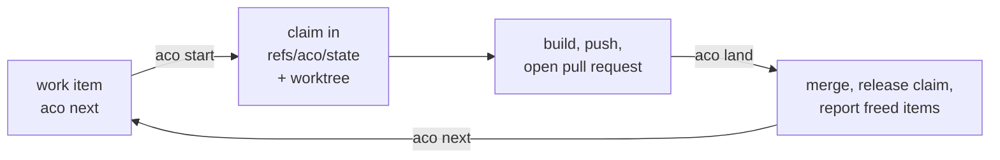

# aco

`aco` gives coding agents and the people steering them one claim state per
repository: a compare-and-swap git ref, `refs/aco/state`, on the repository's
canonical remote. It is provider-neutral: Codex, Claude, Grok and people use the
same contract. Read this file to install `aco` and run one lane; each command's
exact behaviour is in its spec under `specs/`.

## What aco is for, and is not

A capability belongs in `aco` only if it helps agents coordinate in a shared
repository, holds what an agent would forget or cannot know alone (who holds
what, what a landing freed, what is disjoint), and no native tool does it
better. Git, `gh` and the forge own commits, branches, pull requests and issue
text. aco runs no lease server and writes no provider configuration. GitHub
through `gh` is the one forge adapter; `status`, `bootstrap`, `reset`, lane
`claim`/`rescope` and `release --abandoned` read and write only `refs/aco/state`
and need no forge. `release --merged` needs it under `storage = "github"`.

## Install

```bash
uv tool install git+https://github.com/overnightworks/aco.git
# or: pipx install git+https://github.com/overnightworks/aco.git
uv tool upgrade overnightworks-aco
uv tool uninstall overnightworks-aco
```

The supported Python range is in `pyproject.toml`.

## One lane



Set `ACO_AGENT` to the agent's name once: `start` refuses in a plain
shell without it. A repository adopts aco by landing one commit that adds an
empty `.aco/board.toml` and nothing else, then runs `aco bootstrap` once to
create the state ref (`specs/bootstrap.spec.md`, `specs/storage-pin.spec.md`).
After that: `aco next` names the item to pull, `aco start <n>` creates its
worktree and branch and claims its scope, `aco brief <n>` prints what a builder
starts from, and `aco land <pull request> --head <sha>`, from a clean
default-branch checkout, merges a green pull request pinned to the head the
reviewers saw and releases the claim (`specs/start.spec.md`,
`specs/brief.spec.md`, `specs/land.spec.md`).

## Other modes

- **Issueless lanes.** On a `docs/` or `fix/` branch, `aco claim --scope PATH`
  claims without an issue; the pull request carries `No-Item: docs|fix|deps`
  and `aco release --merged <pull request>` ends the claim once the forge shows
  the merge (`specs/claim.spec.md`, `specs/landing-grammar.spec.md`).
- **Foreign pull requests.** `aco adopt <pull request> --no-item <kind>` turns
  a bot's pull request into such a lane (`specs/adopt.spec.md`).
- **No forge.** Pinning `storage = "state-ref"` keeps items as files; use
  `aco item new/show/edit/close` and land with a `Work-Item:` trailer on the
  trunk commit; `aco release --merged <sha>` checks the local trunk, not a forge
  (`specs/storage-pin.spec.md`, `specs/item.spec.md`, `specs/release.spec.md`).

## Configuration

A tracked `.aco/board.toml` on the trunk may set these top-level keys; any
other key is refused by name (`specs/storage-pin.spec.md`).

| Key | Meaning (default) |
|---|---|
| `storage` | `"github"` (default) or `"state-ref"` |
| `canonical_remote` | git remote holding the state ref and naming the trunk (`origin`) |
| `priority_labels` | ordered labels ranking critical work (`security`, `data`, `ci`, `product`, `ux`, `cleanup`) |
| `idea_label` | label marking an idea, never proposed by `next` (`idea`) |
| `merge_method` | `"merge"` or `"squash"` for `aco land`; absent, the forge's allowed method (`specs/land.spec.md`) |
| `body_contract` | only `"block"` is accepted; absent means the same |
| `lane_shared` | repository files a lane may change beyond its scope |
| `dependency_paths` | paths a `No-Item: deps` pull request may change; a trailing `/` covers a directory |

## Board

`aco board --json` projects the open work board read-only for agents and
scripts. `aco serve [--port N] [--repo PATH]...` serves the open
expectation lines of one or more repositories as decision cards on 127.0.0.1
(an item's open option lines are one card, decided by a letter per line, Accept all,
Other… or Unclear, stored all or none); the
access token travels only in the printed URL's `#` fragment and survives
restarts in a user-only file (deleting it rotates the token)
(`specs/serve.spec.md`). The browser app lives in `frontend/`; its build
output is committed under `src/aco/board/static/`.

## Machine output

Most commands accept `--json` and print one object on stdout, refusals
included. Read the exit code first, then `ok` and `reason`; branch on `reason`,
never on prose (`specs/output.spec.md`).

## Commands and their specs

`aco --help` lists the commands and `aco <command> --help` their flags. Each
command's behaviour, printed literals, exit codes and `--json` shapes are in
`specs/<command>.spec.md`. The
rules several commands share (output envelope, body block, claim record,
landing grammar, storage pin, state ref transport) are in
[`specs/`](specs/) too.

## Documentation

`specs/` holds the behaviour contracts, `docs/decisions/` the decision record
([claim state without a ledger issue](docs/decisions/0001-claim-state-without-a-ledger-issue.md)),
and [`docs/board/mockup.html`](docs/board/mockup.html) the frozen picture of the
board surface.
