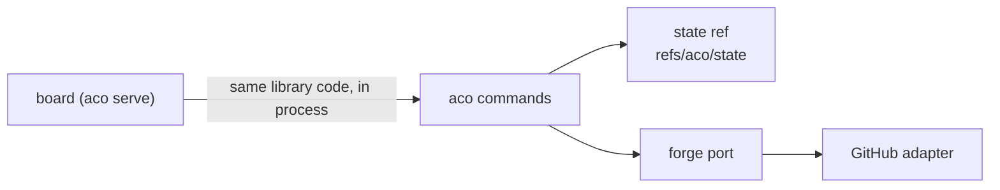

# Architecture

For an agent or maintainer who needs aco's mental model before changing it.
Behaviour, printed literals and exit codes are in `specs/`; this page holds
only what no spec owns.

## Mental model

aco coordinates agents working in one repository. Claims live in git, work
items live on the forge, and the commands join the two.

- The **state ref** is one git ref on the configured canonical remote
  (`canonical_remote` in `.aco/board.toml`; its default is set by PIN-50 in
  `specs/storage-pin.spec.md`). Its tree is the current state: `claims/`,
  `resources/`, `ids/`, `schema.toml` (the format version) and, for a repository
  without a forge, items.
- A transition is a pure function from the observed state and a typed intent
  to a new state (`protocol.apply`). The store commits it on the observed tip.
  Only `aco reset --confirm` forces (CAS-43). A rejected push is not a failure
  by itself. The wire contract and the retry and failure semantics, including
  rejections that are not a race, are in `specs/ref-store-cas.spec.md`.
- A resource is a number that must stay unique repository-wide.
  `specs/claim-record.spec.md` owns the allocation outcomes.
- Ownership of item facts on GitHub: kind is the forge's native issue type
  (`Container`, `Task`, `Bug` or `Feature`; an unrecognized type maps to no
  kind, never guessed from a label), and parent and blocker relations are the
  forge's sub-issue and blocked-by relations. The body repeats neither beyond
  what `specs/cut.spec.md` and `specs/body-block.spec.md` own. An item's
  contract is one fenced TOML block, specified in `specs/body-block.spec.md`.
- The **forge port** (`forge.py`) is the seam most commands use to reach a
  forge. It raises typed errors (`ForgeNotFoundError`,
  `ForgePermissionDeniedError`, `ForgeTransientError` and the rest of its
  family), so no caller matches error text. An adapter that cannot do an
  operation raises `ForgeUnsupportedError`. The one capability a caller
  branches on is `BoardSource.lists_pull_requests`. GitHub is the only forge
  adapter; the state-ref item store implements the same port. The seam is not
  exclusive: `cmd_land` depends on `GitHubForge` for the whole landing,
  `cmd_item` on `StateRefBoard` and `cmd_release` on both, so another forge
  needs its own contract for them before it can attach (the module docstring
  of `forge.py`).

## Architectural Decisions

One line per standing choice: the rule, its reason and the rejected
alternative that keeps coming back.

- Claims live in the state ref, one tree of `claims/` and `resources/`. The ref
  has one serialization point. Rejected: per-item claim comments, because the
  comment API has no conditional write, so two agents can both post and neither
  loses, and a lane without an issue has no comment to hold; the assignee as the
  lock, because it has no compare-and-swap and names a forge account, not the
  agent and session holding the claim; Projects v2 fields, because they have no
  demonstrated compare-and-swap and add a synchronisation step and tie the
  claim's compare-and-swap, which is a pure git push today, to a forge API; one
  ref per key plus a resources ref, because a resource-holding claim would have
  its hold and its number in two owners that can disagree, and making them one
  transition needs `git push --atomic` across refs, which is unverified on
  GitHub.
- The state ref advances by a plain fast-forward push. A push already accepts
  fast-forwards and rejects the rest, which is the serialization needed, and a
  matching `--force-with-lease` can replace history. Rejected: the lease,
  because it opens that history-loss path.
- A released claim is absent from the tree and readable at the parent commit.
  The commit message names the transition. Rejected: a second history ref,
  because the parent commit already holds the history.
- A resource is allocated in the same commit as the claim that requests it, so
  two lanes racing for it serialize on the one ref. No cross-key invariant
  then rests on a server capability.
- The storage pin is read from configuration and never chosen at run time from
  forge capabilities. Rejected: runtime capability selection, because a forge
  plan change would silently move a fact's owner without a migration.
- Wide-scope thresholds are protocol constants, not configuration, so two
  fleets in one repository cannot disagree on what "too wide" means.
- The state-ref item store and the board stay although nobody uses them (see
  "Kept although unused"). Rejected: deleting them, because the operator may
  still take them into use and a repository without a forge, or deciding by
  page, would then need a rebuild.

## Kept although unused

Two parts have no user today and stay by the operator's ruling of 06.11.2026
(#658). Of the state-ref item store (`storage = "state-ref"`, `aco item`):
„nein wir behalten ihn, und auch das board! das wird noch nichtgenutzt aber
ggf überlege ich es mir ja noch! wir könne beides irgendwo vermerken, falls
die entscheidung nochmal kommt!“

- **The state-ref item store** keeps items as files in the state ref for a
  repository without a forge (`specs/storage-pin.spec.md`).
- **The board** (`aco serve`, `src/aco/board/`, `frontend/`) lets the
  operator decide by page. It is frozen: nothing more is built at it
  (aco#648).

A later ballast audit names both as kept and refreshes the numbers in #658
(size, usage, upkeep); it does not raise them as new findings. Every change to
`session`, `store` and the item commands still carries both storage paths.

## Crosscutting Concepts

### Trust

The trust model is cooperating clients: the state ref and `aco rule --via` are
aids for cooperative agents (`specs/rule.spec.md` declares `--via` a tripwire),
and the forge's permissions and edit history are the boundary against anyone
else.
Claimants need push rights to the canonical remote. The board adds its own
boundary: every `/api/` request must carry the token before any forge request
is made (`specs/serve.spec.md`).
