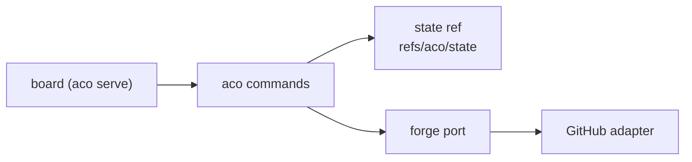

# Architecture

For an agent or maintainer who needs aco's mental model before changing it.
Behaviour, printed literals and exit codes are in `specs/`; this page holds
only what no spec owns.

## Mental model

aco coordinates agents working in one repository. Claims live in git, work
items live on the forge, and the commands join the two.

- The **state ref** is one git ref on the configured canonical remote
  (`canonical_remote` in `.aco/board.toml`; its default is PIN-50 in
  `specs/storage-pin.spec.md`). Its
  tree is the current state: `claims/`, `resources/`, `ids/` and, for a
  repository without a forge, items. The commit message names the transition.
  A released claim is absent from the tree and readable at the parent commit,
  so there is no second history ref.
- A transition is a pure function from the observed state and a typed intent
  to a new tree (`protocol.apply`). The store commits it on the observed tip
  and pushes with a plain fast-forward `git push`, never `--force` and never
  `--force-with-lease`, because a matching lease can replace history. A
  rejected push means the state moved: the store re-reads and re-applies the
  original intent. The wire contract is `specs/ref-store-cas.spec.md`.
- A resource (a number that must stay unique repository-wide) is allocated in
  the same commit as the claim that requests it, so two lanes racing for it
  serialize on the one ref and the loser gets the next value.
- Ownership of item facts on GitHub: kind is the forge's native issue type
  (`Container`, `Task`, `Bug` or `Feature`; an unrecognized type maps to no
  kind, never guessed from a label), and parent and blocker relations are the forge's
  sub-issue and blocked-by relations. The body repeats neither. `cut` writes
  a `Parent:` line into a fresh child body only so that a repeated `cut` can
  finish its own half-made relation. An item's contract is one fenced TOML
  block whose keys are protocol and whose values are the operator's prose
  (`specs/body-block.spec.md`).
- Wide-scope thresholds are constants of the protocol, not configuration, so
  two fleets in one repository cannot disagree on what "too wide" means.
- The **forge port** (`forge.py`) is the only way commands reach a forge. It
  raises typed errors (`ForgeNotFoundError`, `ForgePermissionDeniedError`,
  `ForgeTransientError` and the rest of its family), so no caller matches
  error text. An adapter that cannot do an operation raises
  `ForgeUnsupportedError`. The one capability a caller branches on is
  `BoardSource.lists_pull_requests`. GitHub is the only adapter; another forge
  attaches at this port without a rewrite of the commands.

## Kept although unused

Two parts have no user today and stay by the operator's ruling of 06.11.2026
(#658). Of the state-ref item store (`storage = "state-ref"`, `aco item`):
„nein wir behalten ihn, und auch das board! das wird noch nichtgenutzt aber
ggf überlege ich es mir ja noch! wir könne beides irgendwo vermerken, falls
die entscheidung nochmal kommt!“

- **The state-ref item store** keeps items as files in the state ref for a
  repository without a forge (`specs/storage-pin.spec.md`).
- **The board** (`aco serve`, `src/aco/board/`, `frontend/`) lets the
  operator decide by page. It is frozen: nothing more is built at it
  (aco#648).

A later ballast audit names both as kept and refreshes the numbers in #658
(size, usage, upkeep); it does not raise them as new findings. Every change to
`session`, `store` and the item commands still carries both storage paths.

## Trust

The trust model is cooperating clients: the state ref and `aco rule --via` are
aids for cooperative agents (`specs/rule.spec.md` declares `--via` a tripwire),
and the forge's permissions and edit history are the boundary against anyone
else.
Claimants need push rights to the canonical remote. The board adds its own
boundary: every `/api/` request must carry the token before any forge request
is made (`specs/serve.spec.md`).
