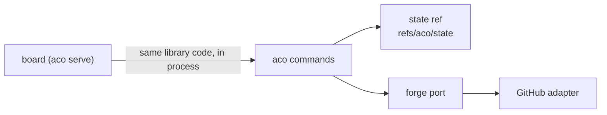

# Architecture

For an agent or maintainer who needs aco's mental model before changing it.
Behaviour, printed literals and exit codes are in `specs/`; this page holds
only what no spec owns.

## Mental model

aco coordinates agents working in one repository. Claims live in git, work
items live on the forge, and the commands join the two.

- The **state ref** is one git ref on the configured canonical remote
  (`canonical_remote` in `.aco/board.toml`; `specs/storage-pin.spec.md` owns
  its default). Its tree is the current state: `claims/`,
  `resources/`, `ids/`, `schema.toml` (the format version) and, for a
  repository without a forge, items.
- A transition is a pure function from the observed state and a typed intent
  to a new state (`protocol.apply`). The store commits it on the observed tip.
  A rejected push is not a failure by itself. The wire contract, the retry and
  failure semantics and the one forced write are in
  `specs/ref-store-cas.spec.md`.
- A resource is a number that must stay unique per resource name.
  `specs/claim-record.spec.md` owns the allocation outcomes.
- On GitHub, kind is the forge's native issue type (`Container`, `Task`,
  `Bug` or `Feature`; an unrecognized type maps to no kind, never guessed from
  a label). An item's contract is one fenced TOML block, specified in
  `specs/body-block.spec.md`.
- The **forge port** (`forge.py`) is the seam most commands use to reach a
  forge. Its error types are `ForgeNotFoundError`,
  `ForgePermissionDeniedError`, `ForgeTransientError` and the rest of its
  family. An adapter that cannot do an operation raises
  `ForgeUnsupportedError`. The one capability a caller
  branches on is `BoardSource.lists_pull_requests`. GitHub is the only forge
  adapter; the state-ref item store implements the same port. The seam is not
  exclusive: `cmd_land` depends on `GitHubForge` for the whole landing,
  `cmd_item` on `StateRefBoard` and `cmd_release` on both, so another forge
  needs its own contract for them before it can attach (the module docstring
  of `forge.py`).

## Crosscutting Concepts

### Trust

The trust model is cooperating clients: the state ref and `aco rule --via` are
aids for cooperative agents (`specs/rule.spec.md` declares `--via` a
tripwire). Against anyone else the forge's permissions enforce who may write,
and its edit history records afterward what was written; it does not stop an
agent acting under the operator's own identity. Claimants need push rights to
the canonical remote. The board adds its own boundary, described in
`specs/serve.spec.md`.

## Constraints and reasons

- Claims live in the state ref, one tree of `claims/` and `resources/`. The
  ref is the one serialization point, and a claim needs no issue, so a lane
  without one can hold it.
- Kind and the parent and blocker relations live on the forge's native
  fields, so each fact has one owner: no reader derives a kind, parent or
  blocker from the body. The `Parent:` line `aco cut` writes is a recovery
  marker (`specs/cut.spec.md`, `specs/body-block.spec.md`).
- Forge errors are typed, so no caller matches error text.
- The state ref advances by a plain fast-forward push. A push already accepts
  fast-forwards and rejects the rest, which is the serialization needed; a
  matching `--force-with-lease` can replace history, so it is not used.
- A released claim is absent from the tree and readable at the parent commit.
  The commit message names the transition, so the parent commit is the whole
  history.
- A resource is allocated in the same commit as the claim that requests it, so
  two lanes racing for it serialize on the one ref. No cross-key invariant
  rests on a server capability.
- The storage pin is read from configuration and never chosen at run time from
  forge capabilities, so a forge plan change cannot silently move a fact's
  owner without a migration.
- Wide-scope thresholds are protocol constants, not configuration, so two
  fleets in one repository cannot disagree on what "too wide" means.
- Configuration in `.aco/board.toml` holds only settings with a caller today,
  because an option without a caller is upkeep with no user.
- The state-ref item store and the board are kept although nobody uses them.
  The store keeps items as files in the state ref for a repository without a
  forge (`specs/storage-pin.spec.md`). The board (`aco serve`,
  `src/aco/board/`, `frontend/`) lets the operator decide by page; it is
  frozen, and nothing more is built at it. Every change to `session`, `store`
  and the item commands still carries both storage paths. Both are known and
  deliberately kept; they are not unnoticed dead code.

## Not chosen

- Per-item claim comments: the comment API has no conditional write, so two
  agents can both post and neither loses, and a lane without an issue has no
  comment to hold. Reopens if the forge's comment API gains a conditional
  write.
- The assignee as the lock: it has no compare-and-swap and names a forge
  account, not the agent and session holding the claim. Reopens if a forge
  offers an atomic assignee swap that identifies the session.
- Projects v2 fields: no demonstrated compare-and-swap, an added
  synchronisation step, and it ties the claim's compare-and-swap, a pure git
  push today, to a forge API. Reopens if a forge field offers a verified
  compare-and-swap.
- One ref per key plus a resources ref: a resource-holding claim would have
  its hold and its number in two owners that can disagree, and one transition
  over both needs `git push --atomic` across refs. Reopens when that is
  verified on the forge.
- `--force-with-lease` for advancing the state ref: it opens a history-loss
  path. Reopens if a lease can be made to reject non-fast-forward updates.
- A second history ref: the parent commit already holds the history. Reopens
  if a reader needs history that the parent chain cannot give.
- Runtime capability selection of the storage owner: a forge plan change would
  silently move a fact's owner without a migration. Reopens if the move gets a
  migration that runs with it.
- Renaming `.aco/board.toml`: it costs a migration to buy a better name.
  Reopens when a migration is needed anyway.
- Deleting the state-ref item store and the board: the operator may still take
  them into use, and a repository without a forge, or deciding by page, would
  then need a rebuild. Reopens when the operator decides to drop them.
