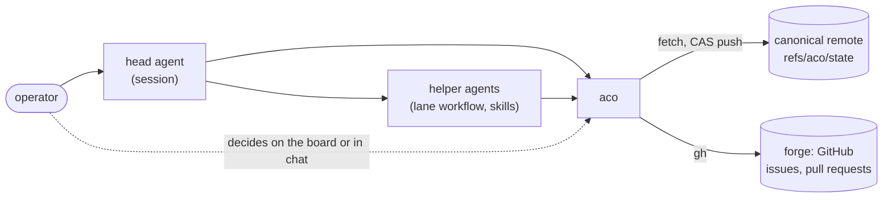
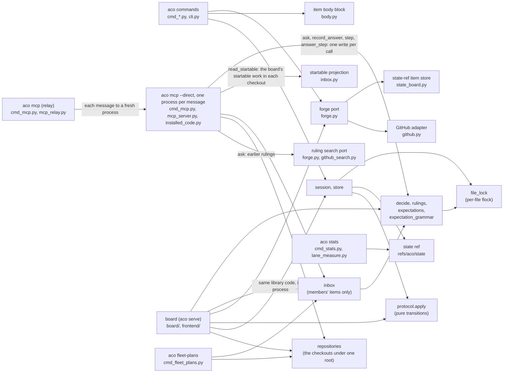
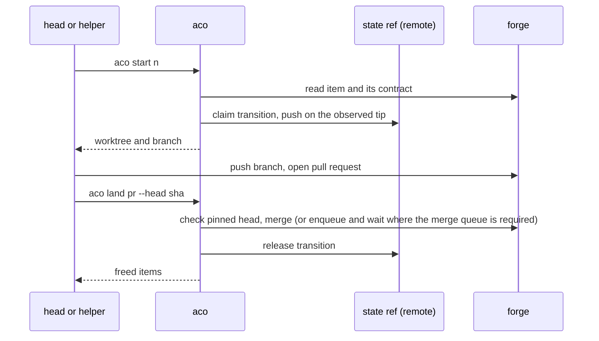

# Architecture

For an agent or maintainer who needs aco's mental model before changing it.
Behaviour, printed literals and exit codes are in `specs/`; this page holds
only what no spec owns.

## Context and Scope

aco coordinates agents working in one repository. Claims live in git, work
items live on the forge, and the commands join the two. It runs no lease or
coordination server. An agent
host can start `aco mcp` for one session (`specs/mcp.spec.md`).

Git and the forge own commits, branches, pull requests and issue text; the
README holds installation and the lane in user terms.

## Building Block View

- The **state ref** is one git ref on the configured canonical remote
  (`canonical_remote` in `.aco/board.toml`; `specs/storage-pin.spec.md` owns
  its default). Its tree is the current state: `claims/`,
  `resources/`, `ids/`, `schema.toml` (the format version), `runs/<claim-id>.json`
  (lane runs, keyed by claim id so a release removes them) and, for a
  repository without a forge, items.
- A transition is a pure function from the observed state and a typed intent
  to a new state (`protocol.apply`). The store commits it on the observed tip.
  A rejected push is not a failure by itself. The wire contract, the retry and
  failure semantics and the one forced write are in
  `specs/ref-store-cas.spec.md`.
- A resource is a number that must stay unique per resource name.
  `specs/claim-record.spec.md` owns the allocation outcomes.
- The GitHub issue types `Container`, `Task`, `Bug` and `Feature` map to the
  four kinds; an unrecognized type maps to no kind, never guessed from a
  label. An item's contract is one fenced TOML block, specified in
  `specs/body-block.spec.md`.
- The **forge port** (`forge.py`) is the seam most commands use to reach a
  forge; its errors are typed, so no caller matches error text, and an adapter
  that cannot do an operation raises `ForgeUnsupportedError`. GitHub is the only forge adapter; the state-ref item
  store implements the same port. The seam is not exclusive: `cmd_land` depends
  on `GitHubForge` for the whole landing, `cmd_item`, `cmd_item_edit` and
  `cmd_item_common` on `StateRefBoard` and `cmd_release` on both, so another
  forge needs its own contract for them before it can attach (the module
  docstring of `forge.py`).
- The **ruling search** (`forge.RulingSearch`) is a port of its own, because it
  spans owners where the reader is bound to one repository. The `ask` tool of
  `aco mcp` filters its hits with the pure `earlier_rulings.py`.
- The **board probe** (`forge.BoardProbe`) is a third port of its own: whether an
  issue, or a repository's newest one, changed since an opaque token. Its GitHub
  adapter (`github_probe.py`) reads the status line itself, because `gh` exits
  non-zero on the 304 that means unchanged. `aco wait` without an item asks it.

## Runtime View

The core flow of one lane; behaviour is in `specs/start.spec.md`,
`specs/claim.spec.md`, `specs/land.spec.md` and `specs/release.spec.md`.

## Deployment View

aco is a CLI installed per machine (the README owns installation); every
machine reaches the same state ref on the canonical remote, which is the
only shared state besides the forge. The board is a local process the
operator starts with `aco serve`, by hand or by a unit; it keeps no
coordination state of its own, only its access token file and the call record; the
root it scans comes from aco's config file (`specs/serve.spec.md`). `aco mcp` is the same
kind of process: an agent host starts it over stdio for one session and it ends
when the host closes stdin; it keeps no state but the call record and scans the same root
(`specs/mcp.spec.md`). The process the host starts holds no tool code: each message runs
in a fresh `aco mcp --direct` from the installed package, so a reinstall reaches running
sessions without a reconnect, which an interactive host would never repeat after the
server exited. Nothing else is deployed.

## Crosscutting Concepts

### Trust

The trust model is cooperating clients: the state ref and `aco rule --via` are
aids for cooperative agents (`specs/rule.spec.md` declares `--via` a tripwire;
`specs/landing-grammar.spec.md` does the same for the landing checks of changed
paths, LAND-71 and LAND-87; `specs/lane-record.spec.md` for the landing checks of a lane record, LANREC-99 and LANREC-100, under aco#1064 line 1). The boundary against a lying agent is agents under their own OS user (platform#885), not built. The `record_answer` tool of `aco mcp` takes the
agent's word that the operator spoke and checks nothing of it. Against anyone
else the forge's permissions enforce who may write, and its edit history
records afterward what was written; neither stops an agent acting under the
operator's own identity. Claimants need push rights to the canonical remote.
The board adds its own boundary (`specs/serve.spec.md`): a card reaches it only
from an item a member of the repository wrote (GitHub's `OWNER`, `MEMBER` or
`COLLABORATOR` author association; an unknown association counts as a
stranger's; a state-ref item counts as a member's, since only a writer of the
state ref can create one), because in a public repository a stranger can open an
issue carrying a card. `inbox.py` owns that per-repository read; `aco rulings`
and `aco next` stay unfiltered, and so is `read_startable` of `aco mcp`, which
projects the board `aco board --json` builds in each repository's checkout. It
and `aco fleet-plans` share the discovery and the concurrent read and keep no
state. The write tools of `aco mcp` and the
board's step answer each write one line or wait in the item's turn
(`specs/mcp.spec.md`, `specs/serve.spec.md`); `record_answer` refuses neither a
closed item nor a non-member's, because the card's hash binds the answer to what
the agent read. The ruling search of `ask` shows earlier rulings and applies
none; a line from a private repository can reach a head working in a public one,
as the inbox already allows.

`aco stats` compares two groups of lanes by the records on the state ref's
release commits; it writes nothing and asks no forge
(`specs/stats.spec.md`).

### The GitHub call record

Every `gh` call an aco process starts leaves one JSON line in `github-calls.jsonl` under the
state directory: the command, the repository, the quota the call spends (core, GraphQL, search
or none) and how it ended. `github_calls.py` owns it, and `github.py` records at the two places
that start `gh`. `github_failure.py` owns the quota of a call and derives from it the limit a
refusal names. The record is always on and needs no setting, because the sessions worth
measuring run for hours: one append is cheap against a `gh` process, and a past window can be
read after the fact. Two files of at most 32 MiB each bound it. A failed write costs the command
one warning and nothing else (`specs/github-calls.spec.md`).

### The per-item turn

Most writes of an item's body run under one per-item lock
(`decide.item_lock`): an exclusive `flock` (`file_lock`) on one file per item
under aco's state directory, named by a digest of the forge repository id and
the item number. `decide.turn` is that lock plus the fresh read, then one write;
the item and claim commands, `aco mcp` tools and the board write under the lock
through `decide.write_item_body`, the one writer, except a whole-body `aco item edit`
under `state-ref`, which calls the board directly. `aco adopt` and the land
queue write through the forge writer, unlocked. A writer that finds
the lock held prints one line to stderr and waits, so writers here never
overwrite each other's bodies. A whole-body `aco item edit` also compares
the hash it names (`--base`) with a fresh read under the lock, so a stale copy is
refused, never merged.

GitHub's REST API has no conditional body write, so a hand edit or another
machine between read and write is not prevented, and a write past aco
(`gh issue edit`, a browser tab) is not seen. After each GitHub write the
adapter reads the item's newest two edit revisions and raises a typed answer
when its write was overwritten, kept over an unread change, or cannot be
verified; an edit saved after that read overwrites unseen. Under
`state-ref` the store's compare-and-swap refuses a write from a stale snapshot.

### The ruling signal

`decide.rule` and `decide.withdraw`, the one write of a ruled, returned or
withdrawn line, touch one signal file per item after the verified write, named
by the same digest as the item's lock (`decide.item_signal_path`). `aco wait`
watches that file's modification time instead of reading the item on every tick; the signal
carries no content, names no asker and never fails a write
(`specs/wait.spec.md`).

An idle head's `aco wait` without an item watches its own board
(`board_wait.py`); no service stands behind it, because one head waits per
repository and a service would save no request. The signal files wake it within
seconds of a ruling, and a cheap check decides when to read the rest: the state
ref's tip and, under GitHub storage, one conditional request (`BoardProbe`) for
the newest updated issue and for each open blocker elsewhere. A hit on the newest
updated issue lists the open issues and pull requests first and reads the board only
when they differ from the last read's rows; a blocker elsewhere asks for a read only
when its own answer shows it closed. A board read also
ends it on a due recurring audit, judged by `board_read.recurring_audit_reading`; the
anchor is listed again only when the newest trunk landing or the day changed.

### Logging

`aco serve` is the one deployed process and the one logline host: it configures
the fleet's logger once, as `aco-board`, and only `aco.board` imports it. After
the URL its stdout is one JSON record per answered request plus its start and
stop lines (`specs/serve.spec.md`). `aco mcp` keeps stdout for JSON-RPC, and no
other command logs.

### Proof strategy

`specs/` owns each command's behaviour, with criterion IDs that tests
cite. CI is the gate; its `quality` job runs the fleet quality gate,
whose ratchets over `quality/baseline.toml` let size and complexity shrink
but not grow.

## Constraints and reasons

- Claims live in the state ref, one tree of `claims/` and `resources/`. The
  ref is the one serialization point, and a claim needs no issue, so a lane
  without one can hold it.
- On GitHub, kind and the parent and blocker relations live on the forge's
  native fields (issue type, sub-issue, blocked-by), so each fact has one
  owner and no reader derives one from the body. Under the state-ref item
  store, the block's `[record]` table is that owner
  (`specs/storage-pin.spec.md`).
- The state ref advances by a plain fast-forward push: a push already accepts
  fast-forwards and rejects the rest, which is the serialization needed.
- A claim's holder changes only through `aco handover`, which records the takeover on
  the item and in the transition's commit trailers.
- A released claim is absent from the tree and readable at the parent commit.
  The commit message names the transition, so the parent commit is the whole
  history.
- A resource is allocated in the same commit as the claim that requests it, so
  two lanes racing for it serialize on the one ref. No cross-key invariant
  rests on a server capability.
- The storage pin is read from configuration, never from forge capabilities
  (`specs/storage-pin.spec.md`).
- Wide-scope thresholds are protocol constants, not configuration, so two
  fleets in one repository cannot disagree on what "too wide" means.
- `.aco/board.toml` gains a setting only when that setting has a caller,
  because an option without one is upkeep with no user.
- The board (`aco serve`, `src/aco/board/`, `frontend/`) is the operator's
  decision surface: his questions, from every repository under one root
  (`repositories.py`, `specs/serve.spec.md` ABRD-14), in use and growing.
  Its Progress view keeps no state (`progress.py`, ABRD-131).
- The state-ref item store is kept, unused today, for a repository without a
  forge (`specs/storage-pin.spec.md`). Every change to `session`, `store` and
  the item commands still carries both storage paths, deliberately.

## Not chosen

- Per-item claim comments: no conditional comment write, and a lane without
  an issue has none to hold. Reopens if the comment API gains one.
- The assignee as the lock: no compare-and-swap, and it names an account, not
  the session. Reopens if a forge swap names the session atomically.
- Projects v2 fields: no demonstrated compare-and-swap, and they tie the claim's
  git push to a forge API. Reopens on a verified forge compare-and-swap.
- One ref per key plus a resources ref: hold and number would sit in two
  owners. Reopens when `git push --atomic` across refs is verified.
- `--force-with-lease` for the state ref: it opens a history-loss path. Reopens
  if a lease can reject non-fast-forward updates.
- A second history ref: the parent commit already holds the history. Reopens if
  a reader needs history the parent chain lacks.
- Runtime capability selection of the storage owner: a forge plan change would
  move a fact's owner silently. Reopens with a migration that runs alongside.
- Renaming `.aco/board.toml`: a migration to buy a better name. Reopens when a
  migration is needed anyway.
- Deleting the board: it removes the operator's decision surface. Reopens when
  the operator drops it.
- Deleting the state-ref item store: a repository without a forge would need a
  rebuild. Reopens when the operator drops it.

## Risks and Technical Debt

- Two storage paths are carried by `session`, `store` and
  the item commands (see Constraints and reasons).
- The forge seam is not exclusive (see Building Block View): a second forge is
  more than one adapter.
- GitHub access goes through the `gh` CLI, whose output and permissions aco
  does not control; errors are typed at the adapter, not prevented.
- Trust is cooperative; see Trust above.
- Files and functions above the size thresholds are listed in
  `quality/baseline.toml` and shrink only in owned slices.
